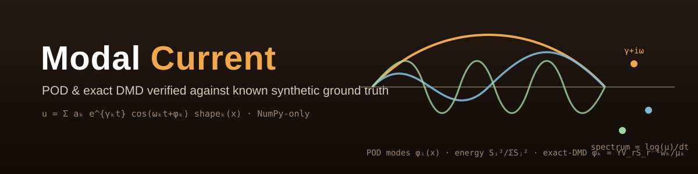
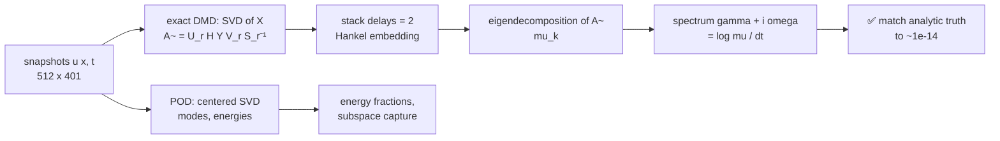
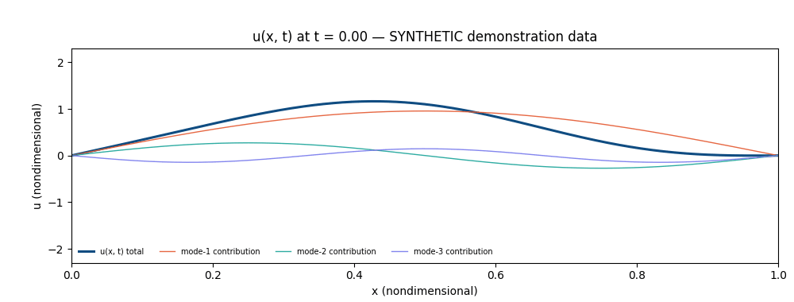

<div align="center">



# 🎼 Modal Current

### POD & exact DMD verified against known synthetic ground truth

**An original Python/NumPy implementation of Proper Orthogonal Decomposition and
Dynamic Mode Decomposition, verified against a synthetic spatiotemporal field whose
modal frequencies and growth rates are known by construction — recovered to ~1e-14
relative error (noise-free).**

[](https://github.com/khalil-official/modal-current/actions/workflows/ci.yml)
[](LICENSE)
[](requirements.txt)
[](tests)
[](docs/verification.md)
[](requirements.txt)
[](https://github.com/khalil-official/modal-current/stargazers)

[Quick start](#-quick-start) · [Method](#-method-summary) · [Animation](#%EF%B8%8F-results-gallery) · [Metrics](#-measured-recovery-metrics-synthetic-demonstration-data) · [References](#-references-by-title)

</div>

---

## 🎯 Purpose and scope

Modal Current decomposes a documented **synthetic** spatiotemporal field

```text
u(x, t) = sum_k  a_k * exp(gamma_k * t) * cos(omega_k * t + phi_k) * shape_k(x)
```

with POD and exact DMD. Because the ground truth is documented, **every decomposition
claim in this repository is checkable**: POD must return exactly 3 nonzero modes with
the right energy split and subspace; exact DMD must recover the three frequencies
`omega = {2.0, 5.0, 9.5}` and growth rates `gamma = {-0.05, +0.02, -0.12}` — and it
does, to ~1e-14 relative error (noise-free).

| Goal | Detail |
| --- | --- |
| 📦 **Reference implementation** | small, readable, dependency-light (NumPy-only core) POD + exact DMD |
| 🔬 **Verification discipline** | reconstruction, held-out extrapolation and noise robustness against known truth |
| 🧭 **Honest boundaries** | why separable standing modes need a time-delay (Hankel) embedding before exact DMD |

> **Out of scope:** any claim about physical flows, turbulence, or experimental data.
> All data here is synthetic.

## 🧮 Method summary

| Component | Construction |
| --- | --- |
| **POD** | economy SVD of the *temporally centered* snapshot matrix (method of snapshots): spatial modes, temporal coefficients, energy fractions `S_i²/Σ S_j²` |
| **Exact DMD** (Tu et al.) | truncated SVD of `X`, projected operator `A~ = U_r^H Y V_r S_r^{-1}`, exact modes `phi_k = (1/mu_k) Y V_r S_r^{-1} w_k`, amplitudes by least squares, continuous spectrum `gamma + i*omega = log(mu)/dt` |
| **Delay embedding** | the field's trajectory spans only `K` spatial dimensions while its dynamics need `2K` state dimensions — plain exact DMD is inconsistent on it (measured: recovered frequencies all zero, 100% error). Stacking `delays=2` snapshots (Hankel DMD) restores exact consistency |

Full derivation in [`docs/model.md`](docs/model.md).

### Snapshots to spectrum



## ⚡ Quick start

```bash
python -m venv .venv && .venv/Scripts/activate   # or source .venv/bin/activate
pip install -r requirements-dev.txt   # runtime + pytest for the documented test flow
pytest                                # 81 tests (incl. eigenvalue/rank contract regressions)
python examples/run_verification.py   # regenerates everything in docs/results/
```

<details>
<summary><b>🧱 Core API (this exact snippet was executed; real output shown)</b></summary>

```python
import numpy as np
from modal_current import compute_dmd, compute_pod, default_times, make_default_field, match_eigenvalues

field = make_default_field()                    # documented 3-mode SYNTHETIC field
times = default_times(dt=0.025, t_end=10.0)
u = field.evaluate(times)                       # (512, 401) snapshots

pod = compute_pod(u)                            # centered SVD
print("POD rank:", pod.rank)
print("energy fractions:", np.round(pod.energy_fractions[:3], 6))

dmd = compute_dmd(u, dt=0.025, delays=2)        # exact DMD, delay-embedded
idx = match_eigenvalues(dmd, [-0.05, 0.02, -0.12], [2.0, 5.0, 9.5])
print("recovered omega:", np.round(dmd.frequencies[idx], 9))
print("recovered gamma:", np.round(dmd.growth_rates[idx], 9))
```

Output (Python 3.13, NumPy 2.1.3):

```
POD rank: 3
energy fractions: [0.561584 0.396457 0.041958]
recovered omega: [2.  5.  9.5]
recovered gamma: [-0.05  0.02 -0.12]
```

</details>

## ✅ Verification summary

81 pytest tests, all passing (`pytest -q`; the six added contract tests cover
alternating-decay Nyquist behavior, zero-eigenvalue impulse reconstruction, and
numerical-rank rejection). Highlights:

- POD energy fractions sum to 1 to roundoff; noise-free data of 3 modes has exactly
  3 nonzero singular values at the machine-precision threshold; the POD basis
  reproduces the analytic shape subspace (> 0.99 asserted, 1.0 measured). The POD
  energy fractions describe the *centered snapshot covariance*, so they are not the
  individual analytic amplitude energies; the subspace verification is the analytic
  claim.
- Exact DMD (Hankel-embedded, delays = 2) recovers every known `omega_k` and
  `gamma_k` to < 1e-10 asserted tolerance (spec target 1e-6; measured ~1e-14).
- Full-rank DMD reconstruction of the training snapshots and short-horizon
  extrapolation beyond the training window are roundoff-level (< 1e-9 / < 1e-8
  asserted; 4.5e-13 / 5.5e-13 measured).
- With the documented 1% Gaussian noise (fixed seed 0), recovered frequencies stay
  within a 1% band (0.07% measured) and growth rates within 0.03 absolute
  (1.0e-2 measured).
- Input validation: finite data, minimum sample counts and `dt > 0` are enforced
  with `ValueError` everywhere.

Details and limits: [`docs/verification.md`](docs/verification.md).

## ⚠️ Limitations

- **SYNTHETIC data only** — nothing in this repository is or validates against
  physical or experimental data; no turbulence claims.
- **DMD linearity assumption** — machine-precision recovery holds because the
  synthetic field is exactly linear (after embedding); nonlinear data inherits DMD's
  linearity bias.
- **Standing modes need the embedding** — `delays=1` exact DMD is provably
  inconsistent for separable standing-mode data (documented, measured, and covered
  by a dedicated test).
- **Noise sensitivity** — growth rates degrade faster than frequencies (|Δgamma| ≈
  1e-2 at 1% noise, comparable to the smallest rate 0.02); rank must be chosen
  explicitly under noise.

---

## 🎞️ Results gallery

<div align="center">

**▶ Watch the three-mode synthetic field evolve:**



<sub>Animation provenance: <b>SYNTHETIC demonstration data</b> generated by this
package (<code>modal_current.synthetic</code>, documented three-mode formula;
512-point grid, dt = 0.025, 60 frames of the actual computed field with per-mode
contributions). It is not a measurement or simulation of any physical flow.</sub>

</div>

### 📈 Measured recovery metrics (SYNTHETIC demonstration data)

Verification configuration: 512 grid points, 401 snapshots, dt = 0.025, noise-free
unless stated. Full machine-readable record:
[`docs/results/run_summary.json`](docs/results/run_summary.json).

| quantity | analytic | recovered (noise-free) | error |
|----------|----------|------------------------|-------|
| omega, mode-1 | 2.0 | 1.99999999999996 | 1.9e-14 rel |
| omega, mode-2 | 5.0 | 4.99999999999990 | 2.0e-14 rel |
| omega, mode-3 | 9.5 | 9.49999999999992 | 8.2e-15 rel |
| gamma, mode-1 | -0.05 | -0.050000000000031 | 3.1e-14 abs |
| gamma, mode-2 | +0.02 | +0.019999999999953 | 4.7e-14 abs |
| gamma, mode-3 | -0.12 | -0.119999999999977 | 2.3e-14 abs |
| POD rank / energy fractions | 3 / — | 3 / 0.5616, 0.3965, 0.0420 | sum = 1 exactly |
| POD subspace capture of each analytic shape | 1.0 expected | 1.0 (±1e-15) | — |
| DMD training reconstruction | — | — | 4.5e-13 rel |
| extrapolation (81 held-out snapshots, 2.02 time units past the window) | — | — | 5.5e-13 rel |
| noise 1% (seed 0): max omega error | — | — | 6.6e-4 rel |
| noise 1% (seed 0): max abs growth error | — | — | 1.0e-2 |
| plain DMD without embedding (documented failure mode) | — | frequencies 0 | 1.0 rel (100%) |

### 🖼️ Static figures

- [POD spectrum](docs/results/pod_spectrum.png)
- [DMD eigenvalues](docs/results/dmd_eigenvalues.png)
- [reconstruction error](docs/results/reconstruction_error.png)
- [recovery table CSV](docs/results/frequency_growth_recovery.csv)

## 📚 Documentation

- [`docs/model.md`](docs/model.md) — synthetic field definition, POD via SVD, the
  exact-DMD construction step by step, why the delay embedding is required.
- [`docs/api.md`](docs/api.md) — API reference.
- [`docs/verification.md`](docs/verification.md) — what each test establishes,
  measured numbers, and the limits of every claim.

## 📚 References (by title)

- *Dynamic mode decomposition of numerical and experimental data* — Schmid
- *Dynamic mode decomposition: Theory and applications* — Tu, Rowley,
  Luchtenburg, Brunton, Kutz
- *Model reduction for flow analysis* — Rowley & Dawson

## 🔑 License

MIT — see [LICENSE](LICENSE). Copyright (c) 2026 MOHAMMED AHMED.
